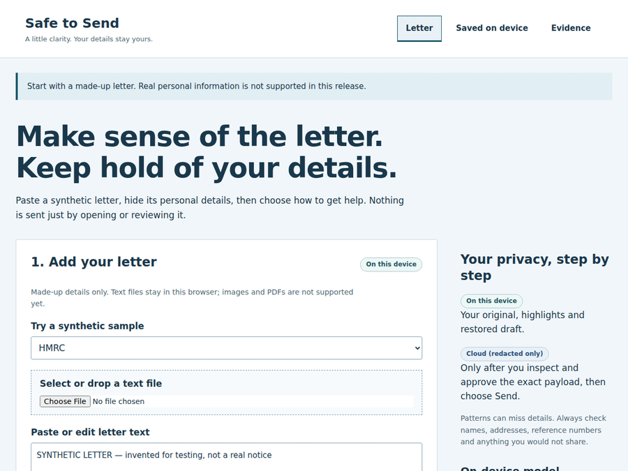
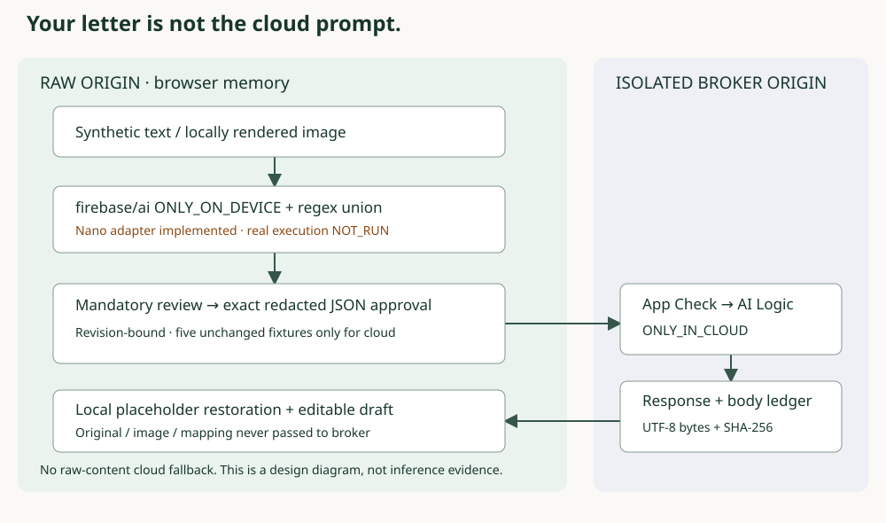

# Safe to Send

**Understand the letter. Keep control of what leaves your browser.**

A stressful tax, benefits, NHS or housing letter should not require pasting your identity into a chatbot. Safe to Send offers a different journey: find personal details locally, review the redactions, approve the exact payload, then get a plain-English explanation, important dates, next actions and an editable reply.

**[Try the live synthetic build](https://safe-to-send-2026.web.app)** · [Measured evaluation](docs/EVALUATION.md) · [Real cloud evidence](docs/evidence/deployed-cloud-cdp-ledger.json)

> **Synthetic letters only.** Real Nano execution is still blocked by device availability. The working local journey uses explicitly labelled templates—not AI. The separate real cloud milestone used registered private debug App Check; it does not prove non-debug Enterprise attestation or a complete on-device-to-cloud journey. Do not enter real personal information.



*Captured from the real local UI; the response is an explicitly labelled deterministic synthetic template, not model inference. [Capture receipt](docs/evidence/product-preview.json).*

**Deployment status:** round-two source is ahead of the live link. Hosting changes are held pending clarification of the no-publishing instruction.

## Try it in under five minutes

Node 24.12+; no card, account, API key or model download needed for the **local preview** (installation time depends on your connection).

```sh
git clone https://github.com/Mizzen-Studios/safe-to-send.git
cd safe-to-send
npm ci
npm run dev
```

Open http://localhost:5192. Choose a synthetic sample, select **Use sample annotations (not AI)** or **Review redactions manually**, edit the marked details, confirm synthetic input and exact-payload review, approve the redacted JSON, then choose the labelled local example. Edit/download the draft. Changing the source or redactions invalidates approval. Local preview needs no Firebase configuration. Release builds bundle strictly allowlisted public Firebase metadata without a config-paste screen; private input files and debug tokens are never committed. The hosted build needs no judge setup. Source checkout uses a key-free local preview unless release metadata is supplied. Supported-device model initialization/download is a separate research step, not part of the five-minute preview.

## Why hybrid, not “upload and hope”?



Firebase AI Logic (`firebase/ai`) is the runtime: an explicit **ONLY_ON_DEVICE** image/text + JSON-schema adapter for detection, and a separate **ONLY_IN_CLOUD** structured explanation adapter. There is no raw-content automatic cloud fallback. The implementation and evidence map to the four equal judging criteria:

1. **Technological implementation of hybrid inference:** explicit local detection plus regex; immutable reviewed redacted cloud requests; local-only answers and a separate local two-key claim checker. Manual review works without Nano, never as an automatic upload fallback. Local answer/checker APIs are implemented and unit-tested; visible UI integration is in progress. Actual Nano inference and two-key catch rate are unmeasured.
2. **Design:** letter-first paste/select/drop flow, highlighted editable redactions, explicit approval, explanation and editable/exportable draft. Saved results/reminder dates use optional local-only IndexedDB; reminders require the app open. Technical panels live in Evidence.
3. **Potential impact:** calmer official correspondence without uploading the original. Manual mode lowers the device barrier. Redaction can miss details; users must review what they send, and check advice against the original.
4. **Idea quality:** the two-key design checks cloud claims against the private original on device, while the exact-body ledger makes the cloud boundary inspectable. It is a model-supported warning mechanism, not a truth guarantee or compliance certification. Spark/free-tier constraints and no paid fallback remain.

[Boundary implementation](docs/CLOUD_HANDOFF.md) · [Supported-device gates and recording plan](docs/DEVICE_TESTING_AND_RECORDING.md) · [Firebase hybrid setup](https://firebase.google.com/docs/ai-logic/hybrid/web/get-started)

## What is actually proven?

- **Local product flow:** review, explicit immutable-payload approval, structured templates, local restoration, draft editing/export and invalidation; [browser QA](docs/evidence/reviewed-journey-browser.json). Templates and mocks are not model execution.
- **One real deployed cloud test:** gemini-3.5-flash-lite through AI Logic with registered private debug App Check. Independent DevTools/CDP body and ledger match: **1766 UTF-8 bytes + SHA-256**; five known HMRC synthetic PII sentinels absent from observed outbound URLs/bodies. [Body-only receipt](docs/evidence/deployed-cloud-cdp-ledger.json) · [ledger capture](docs/evidence/deployed-cloud-ledger.png). Not TLS-byte measurement or a general privacy/semantic-correctness guarantee.
- **App Check negative control:** valid client key without App Check rejected **401**; [receipt](docs/evidence/appcheck-negative-control.json). Non-debug Enterprise attestation remains unverified: [browser launch blocker](docs/evidence/enterprise-attestation-launch-blocker.json).
- **32 synthetic evaluation notices:** six each HMRC/DWP/NHS/council/tenancy, one non-UK and a PII-free negative control. Measured regex character recall **38.59% (406/1052)**, precision **55.62% (406/730)**. Nano, combined, latency and two-key model catch rate: **NOT_RUN**. [Corpus, 96 authored claim mutations, importer and limitations](docs/EVALUATION.md).

```sh
npm test
npm run build
node scripts/evaluate.mjs regex
```

The original five UI fixtures stay unchanged; `npm run eval` still measures that smaller spike. Expanded evaluation is not a cloud-send allowlist. No perfect recall, anonymity, legal advice or policy-compliance promise. IndexedDB history/reminders are implemented and browser-tested; supported-device inference proof remains pending. The product GIF shows actual local UI/template behavior only. Genuine Nano footage remains pending; the linked ledger capture is separate real synthetic cloud evidence.

## Built during the submission period—history disclosed

Owner-supplied start: **11 November 2026, 21:30 UK (21:30 UTC)**. Deadline: **30 November 2026, 22:00 UK**. Eligibility/rules are not independently cleared; the official rules fetch returned 403 and was not bypassed.

A **9 November preparatory spike predates the start**: `20ab95e`, `052a9b0`, `aefd5f4`, `8d5b919`, `9b1ffd3`. It covered privacy gates, five fixtures and the blocked on-device adapter—not explanation/deadlines/actions/drafts or real cloud inference. History/dates are unchanged.

Factual post-start milestones (12 November):
- `ece481f` / `6384297`: mandatory reviewed synthetic explanation/date/action/draft flow and fail-closed preflight/invalidation.
- `447f318` / `06b7c0e`: isolated two-origin handoff, immutable approved bytes, structured cloud SDK path and synthetic-only scope guards.
- `cfbf5cc`: actual deployed debug-App-Check inference and independent DevTools/ledger parity.
- `a096591`: headed Nano eligibility blocker and operator-owned device/recording plan.
- `fd8e434`: 32-notice corpus, offline measured regex scoring and real-output import contract (no model calls).

- `a42b88f`: allowlisted public device metadata build bundle.
- `2044b8d` / `8d670df`: manual-review and revision-bound local-answer/two-key APIs, sender/recipient roles.
- `5fc8405` / `3d913f2` / `8763bb6`: product-first UI, IndexedDB history and keyboard/mobile/drag-drop QA.
- `03a5fd2` / `0c0968a`: free x64 Ubuntu/Windows headed Chrome Nano Actions probe; results pending.

[Full provenance, SDK/runtime caveats and preserved audit links](docs/EVALUATION.md#existing-audit-trail-preserved-from-baseline-a096591). This branch does not deploy, alter DNS/resources, submit or post publicly. Operator owns device tests/recording; the owner need not run setup. Apache-2.0 · [prior attribution](NOTICE).
